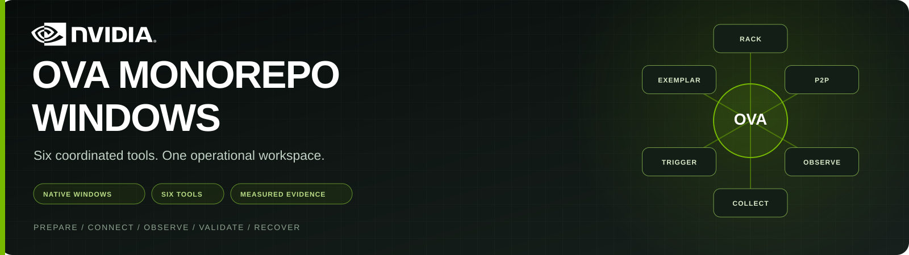
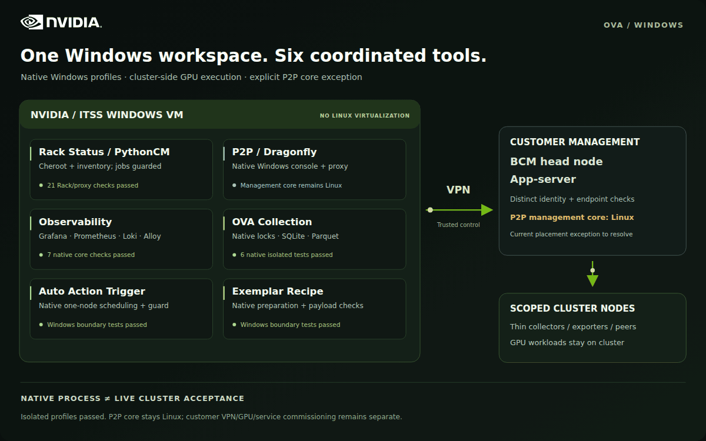

<p align="center"></p>

# NVIDIA OVA Monorepo · Windows

A native Windows management workspace for six OVA tools, with pinned offline dependencies, inspectable source, reproducible builds and recorded Windows acceptance evidence.

**[Download the Windows release](https://gitlab-master.nvidia.com/nvis-ova/OVA-MONOREPO-WINDOWS/-/releases)** · **[Operator guide](docs/OVA-MONOREPO-WINDOWS-User-Guide.md)** · **[PDF guide](docs/OVA-MONOREPO-WINDOWS-User-Guide.pdf)** · **[Validation evidence](VALIDATION.md)**

The management VM runs on the NVIDIA internal network or ITSS infrastructure. Its approved VPN/SSH paths reach the customer BCM head node and app-server. GPU workloads and scoped collectors remain cluster-side. **P2P has one explicit placement exception: its Windows console/proxy controls a Linux-hosted Dragonfly management core.** WSL, a local Linux VM and Linux containers are not required by the native profiles.

## Architecture

<p align="center"></p>

[Static architecture diagram](docs/branding/architecture.svg) · [Measured placement and runtime boundaries](docs/NATIVE_WINDOWS_COMPATIBILITY.md)

## Six tools, clear execution boundaries

| Tool | Native Windows responsibility | Cluster-side responsibility | Start here |
| --- | --- | --- | --- |
| **Rack Status / PythonCM** | TLS/WebSocket backend, UI, ConPTY, durable Windows locks and existing provider interfaces | BCM inventory helpers; qualified scheduler paths | [Native Rack build](windows/rack-p2p/README.md) |
| **NVIS P2P** | HTTPS console/API proxy and controlled SSH forwarding | Dragonfly Manager, scheduler, seed, PostgreSQL/Redis and peers | [P2P native scope](windows/rack-p2p/README.md) |
| **Auto Action Trigger** | One-node cadence, exclusive invocation and receipts; disabled Task Scheduler definition | Original reviewed fanout/launcher and scoped GPU tests | [One-node adapter](windows/auto-action/README.md) |
| **Observability** | Grafana, Prometheus, Loki and Alloy with native Windows binaries | Approved thin exporters and log/metric sources | [Native core operations](windows/observability/OPERATIONS.md) |
| **OVA Collection Framework** | Collection/processing/browser runtime, immutable generations, Windows locks and native supervision | Read-only scheduler/source access and selected capture hooks | [Native collection](windows/collection/README.md) |
| **Exemplar Recipe** | Preparation, target-configuration validation and local payload integrity | Official supported recipes, Slurm/Enroot/Pyxis and GPU execution | [Windows preparation](windows/exemplar/README.md) |

PythonCM inventory and ProgramRunner execution are separate contracts. The reconstructed Rack derivative rejects unqualified PythonCM workflow submissions before they reach the provider; its known environment/user/launch-mode and execution-session gaps are documented. The older `rack-status-pythoncm` snapshot is retained for comparison and does not replace the newer native Rack adaptation.

## Windows acceptance

| Area | Recorded result | Scope |
| --- | --- | --- |
| Windows control CI | **PASS — 7 checks** | Server 2019, PowerShell 5.1, bundled Python; real hashes/extraction and transport guards |
| One-node / Exemplar preparation | **PASS — 9 tests** | Actual Server 2025 with CPython 3.12.10; SSH is mocked and no jobs are submitted |
| Observability | **PASS — 7 checks** | Four real Windows processes, authenticated APIs, metrics/log ingestion, queries and restart persistence |
| Collection | **PASS — 6 tests** | Real kernel locks, concurrent generations, restart/deduplication, redaction and authenticated query/search/export |
| Fresh Rack/P2P reconstruction | **PASS — 21 tests** | Fresh offline environments, TLS/WebSockets, 45-second stability, ConPTY, workflow guard and mock Manager |

These results establish the stated software scopes. Live VPN/customer integration, persistent service commissioning, GPU qualification and reboot/power-loss acceptance require their own evidence. Loki used a recorded forced-stop fallback during isolated restart testing; restart persistence passed, while graceful Loki shutdown remains unqualified. Read [the validation report](VALIDATION.md) and each profile's operations guide before commissioning.

## Get started

Use a short path and Git LFS. Normal clone/pull automatically downloads the native Windows dependencies and bundled control interpreter. Large historical Linux payloads and duplicate top-level archives remain LFS pointers until needed; they are not native Windows deployment prerequisites.

```powershell
git lfs install
git clone https://gitlab-master.nvidia.com/nvis-ova/OVA-MONOREPO-WINDOWS.git C:\OVA
Set-Location C:\OVA
git lfs pull
powershell.exe -NoProfile -ExecutionPolicy Bypass -File tests\Test-WindowsControls.ps1 -RepositoryRoot C:\OVA
```

Application profiles use **native CPython 3.12 x64**, matching the audited VM. Optional offline installers and their provenance are in [windows/runtime](windows/runtime/INSTALLATION.md). The separate Python 3.14 embeddable ZIP in `control/windows` is for control verification, rather than application venvs.

The existing control-test command automatically fetches the historical toolkits it verifies. The offline release builder automatically fetches all included payloads; complete release ZIPs remain ready for disconnected deployment. Downloads use normal Git/LFS credentials. Existing clones retain their previously downloaded files and cache.

Follow the [native operator guide](docs/OVA-MONOREPO-WINDOWS-User-Guide.md) to select a profile, verify its files, create fresh private runtime/evidence directories and run isolated acceptance. Configure actual VPN endpoints, trusted SSH identities, storage, TLS and source scope outside Git before commissioning. Auto Action scheduling is shipped disabled. No collector is implicitly authorized to discover an entire fleet.

## What ships

| Path | Contents |
| --- | --- |
| `windows/` | Native profiles, deterministic derivations, offline Windows dependencies and optional runtime installers |
| `components/` | Expanded upstream sources/toolkits and the separately identified PythonCM comparison snapshot |
| `control/` | Rebuilt Windows control delivery with a strict file manifest and six original toolkits |
| `docs/` | NVIDIA-branded operator guide, PDF, architecture animation and static fallback |
| `evidence/` | Exact acceptance receipts, source bindings, integrity checks and corrections retained from earlier attempts |
| `provenance/`, `SOURCES.json` | Original release identity, component pins and published-derivative history |
| `tests/`, `tools/` | Repeatable acceptance, packaging and document/asset rendering |

The original source distribution contained generated Rack credentials and runtime state. Six files were removed, affected archives/manifests were rebuilt, and Windows testing corrected raw ZIP-name validation. See [sanitation evidence](evidence/sanitization-removals.json) and [current control-archive hashes](evidence/sanitized-artifact-provenance.json). Fresh native builds do not import existing site keys, credentials or inventories.

[Build and validation details](VALIDATION.md) · [Source identities](SOURCES.json) · [Native profile overview](windows/README.md) · [NVIDIA asset provenance](docs/branding/ASSET_PROVENANCE.json)
